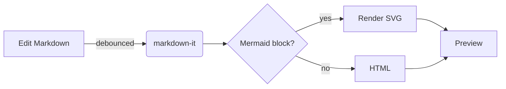
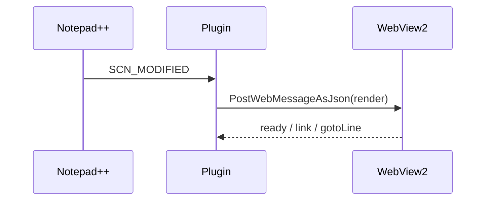

# GRIN-Markdown

**GRIN Renders In Notepad++**: a GitHub Flavored Markdown viewer with Mermaid diagrams.

A dockable live preview panel for Notepad++ that renders Markdown the way GitHub does, including
` ```mermaid ` diagrams. Everything it needs is bundled, so it works offline and loads nothing from a CDN.
Open this README in Notepad++ with the preview to see every feature; the [Showcase](#showcase) below uses them all.

## Features

- **GitHub Flavored Markdown**: tables (with alignment), task lists, ~~strikethrough~~, autolinks,
  footnotes, emoji shortcodes (`:rocket:`), raw HTML, heading anchors, YAML front matter (shown as a table)
- **GitHub alerts**: `> [!NOTE]`, `[!TIP]`, `[!IMPORTANT]`, `[!WARNING]`, `[!CAUTION]`
- **Mermaid diagrams**: flowcharts, sequence, class, state, ER, Gantt, pie, mindmap, and more. Syntax errors are
  shown inline, and rendered diagrams are cached so typing doesn't make them flicker
- **Syntax highlighting** for code blocks (highlight.js, ~40 common languages)
- **Live update** while typing (300 ms debounce), and on tab switch
- **Scroll sync**: the preview follows the editor; **double-click** the preview to jump the editor to that line
- **Light/dark** GitHub styling that follows Notepad++'s dark mode (or force either)
- **Links**: web links open in your browser; relative links to other files open them in Notepad++
  (`other.md#heading` scrolls to the heading); folders and binary files are revealed in Explorer, never run
- **Relative images** (``) load from the document's folder

## Showcase

Everything below renders the same in the GRIN-Markdown preview as it does here on GitHub.

**Bold**, *italic*, ~~strikethrough~~, `inline code`, an autolink: https://github.com, and emoji
shortcodes :rocket: :tada:

> [!NOTE]
> Useful information that users should know, even when skimming content.

> [!WARNING]
> Urgent info that needs immediate user attention to avoid problems.

### Task list

- [x] Tables
- [x] Mermaid diagrams
- [ ] Coffee

### Table

| Feature   | Supported | Notes                        |
| :-------- | :-------: | ---------------------------: |
| Tables    | ✅        | with alignment               |
| Footnotes | ✅        | like this one[^1]            |
| Raw HTML  | ✅        | <kbd>Ctrl</kbd>+<kbd>C</kbd> |

[^1]: Footnotes are collected at the end of the document.

### Code

```cpp
#include <iostream>

int main() {
    std::cout << "Hello, Notepad++!\n";   // syntax highlighted
}
```

### Mermaid





<details>
<summary>Collapsed section</summary>

Hidden content, revealed on click.

</details>

[Back to top](#grin-markdown)

## Requirements

- Notepad++ 8.4.1 or newer (32-bit, 64-bit or ARM64)
- Microsoft Edge WebView2 Runtime, which is part of Windows 10 and 11
  ([download](https://developer.microsoft.com/microsoft-edge/webview2/) if it's missing)

## Install

1. Close Notepad++.
2. Extract `GRIN-Markdown-<version>-<platform>.zip` to `<Notepad++>\plugins\GRIN-Markdown\`. Pick the zip that
   matches your Notepad++ (`Win32` for 32-bit, `x64` for 64-bit). Check under **? > About Notepad++**.
3. Start Notepad++ and choose **Plugins > GRIN-Markdown > Markdown Preview**, or use the
   toolbar button.

The installed folder looks like this:

```
plugins\GRIN-Markdown\
  GRIN-Markdown.dll
  THIRD_PARTY_NOTICES.md
  web\  (index.html, preview.js, mermaid.min.js, CSS)
```

## Settings

**Plugins > GRIN-Markdown > Edit Settings...** opens `GRIN-Markdown.ini`. Changes apply when you save it.

| Key               | Default                                    | Meaning                                         |
| ----------------- | ------------------------------------------ | ----------------------------------------------- |
| `Extensions`      | `.md;.markdown;.mdown;.mkd;.mkdn;.mdwn;…`  | Files that are previewed                        |
| `PreviewAllFiles` | `0`                                        | `1` previews every file (also on the menu)      |
| `SyncScroll`      | `1`                                        | Preview follows the editor (also on the menu)   |
| `Theme`           | `auto`                                     | `auto` (follow Notepad++), `light` or `dark`    |
| `UpdateDelayMs`   | `300`                                      | Delay after typing before the preview refreshes |

The WebView2 cache lives in `%LOCALAPPDATA%\GRIN-Markdown\WebView2`.

## Security

The preview treats documents as untrusted:

- HTML in documents is sanitised with DOMPurify, so `<script>`, event handlers and `javascript:` URLs are removed
- A strict Content-Security-Policy only allows the plugin's own scripts, and Mermaid runs with `securityLevel: 'strict'`
- The page cannot navigate anywhere; every link goes through the plugin, which only opens `http(s)`/`mailto`
  in the browser and never executes local files
- The document folder is exposed to the page only for image, audio and video files
- Remote images in a document (for example badges) are loaded, as they are on GitHub

## Building

You need Visual Studio 2022 or 2026 with the C++ desktop workload, and Node.js 18+.

```powershell
.\build.ps1                          # web assets + Win32 and x64 DLLs
.\build.ps1 -Platform x64 -Package   # also writes dist\GRIN-Markdown-<version>-x64.zip
.\build.ps1 -Platform Win32 -Install # copies into your Notepad++ (close it first; asks for admin rights)
.\build.ps1 -RebuildWeb              # force a rebuild of the web bundle
```

Project layout:

| Path                      | What                                                                      |
| ------------------------- | ------------------------------------------------------------------------- |
| `src/Plugin.cpp`          | Notepad++ plugin exports, menu, notifications, toolbar icon               |
| `src/PreviewPanel.*`      | Docking panel, WebView2 host, document to preview messaging, link handling |
| `src/Settings.*`          | INI settings                                                              |
| `web/src/main.js`         | Renderer: markdown-it with GFM plugins, alerts, Mermaid, scroll sync      |
| `web/build.mjs`           | esbuild bundle into `web/dist` and generates `THIRD_PARTY_NOTICES.md`     |
| `third_party/npp`         | Notepad++ plugin interface headers (v8.9.7)                               |
| `third_party/webview2`    | WebView2 SDK, downloaded by `build.ps1` (pinned version, SHA-256 checked) |
| `res/`                    | Icons (`make_icons.py` regenerates them)                                  |

Web-side debugging: set `WEBVIEW2_ADDITIONAL_BROWSER_ARGUMENTS=--remote-debugging-port=9222` before starting
Notepad++, then open `edge://inspect`. A Debug build also enables DevTools (F12) in the panel.

## Releasing

GitHub Actions (`.github/workflows/build.yml`) builds Win32, x64 and ARM64 on every push and pull request.
To publish a release:

1. Set the new version in `src/resource.h` (`GRIN_VERSION_MAJOR/MINOR/PATCH` and both version strings) and
   commit it. Plugins Admin compares this DLL version with the plugin list.
2. Tag and push:

   ```bash
   git tag v1.0.0
   git push origin v1.0.0
   ```

   The workflow refuses a tag that doesn't match `src/resource.h`. When the builds pass, it creates the GitHub
   release with the three zips. The release notes list each zip's SHA-256 and the ready-made entries for the
   plugin list.

## License

GRIN-Markdown is free software: you can redistribute it and/or modify it under the terms of the
[GNU General Public License v3](LICENSE) or (at your option) any later version. This follows from the
Notepad++ plugin headers it is built with, which are GPL-3.0-or-later.

The bundled components keep their own licenses, all GPL-compatible. They're listed with full texts in
[THIRD_PARTY_NOTICES.md](THIRD_PARTY_NOTICES.md): markdown-it and plugins (MIT/ISC), highlight.js
(BSD-3-Clause), Mermaid (MIT), DOMPurify (Apache-2.0 or MPL-2.0), github-markdown-css (MIT), Scintilla headers
(HPND-style) and the WebView2 loader (BSD-3-Clause). Each release zip includes `LICENSE.txt` and the notices.
